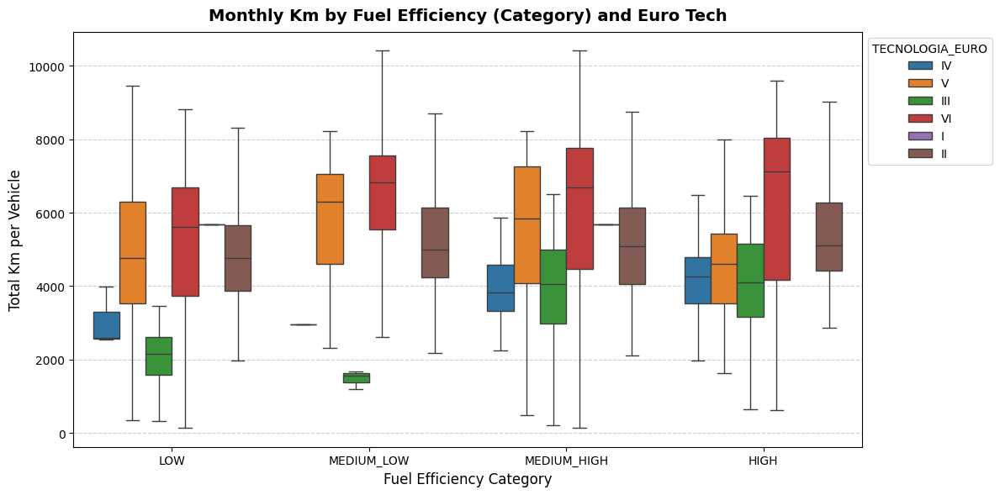

# Fleet Fuel Efficiency EDA


Análisis exploratorio de datos (EDA) sobre una flota de más de 1.000 registros de vehículos de transporte reportados por tres proveedores durante dos meses. El objetivo es entender qué características del vehículo (tecnología Euro, marca y referencia del motor, año, postratamiento) se asocian con un mejor rendimiento de combustible, medido en **kilómetros por galón (Km/Gl)**.



## Preguntas que responde

1. ¿Cómo se distribuye el rendimiento (Km/Gl) en la flota?
2. ¿La tecnología Euro (I a VI) se relaciona con el rendimiento de combustible?
3. ¿Qué marcas y referencias de motor rinden mejor o peor?
4. ¿Influyen el año del vehículo o del motor y el sistema de postratamiento?
5. ¿El consumo reportado por los proveedores coincide con el reporte independiente de combustible?

## Metodología

1. **Carga y unificación:** lectura de los reportes de cada proveedor y concatenación en una sola tabla, con columnas `SUPPLIER` y `PERIOD`.
2. **Limpieza:** normalización de nombres de columnas a mayúsculas, revisión de nulos y duplicados, y eliminación de registros sin kilómetros o consumo.
3. **Métrica principal:** `KM_PER_GL = KM_TOTAL / GL_TOTAL`.
4. **Clasificación por cuartiles:** cada vehículo se etiqueta como `LOW`, `MEDIUM_LOW`, `MEDIUM_HIGH` o `HIGH` según los percentiles 25, 50 y 75 de su rendimiento.
5. **Análisis comparativo:** diagramas de caja de Km/Gl por tecnología Euro, marca y referencia de motor, año, postratamiento y marca de vehículo; tablas cruzadas con la categoría de eficiencia.
6. **Volumen de operación:** kilómetros mensuales por categoría de eficiencia y tecnología (barras apiladas y agrupadas).
7. **Conciliación de datos:** cruce de la flota con los datos de viajes y comparación del consumo reportado con el reporte de combustible verificado.

## Estructura del repositorio

```
fleet-fuel-efficiency-eda/
├── README.md
├── requirements.txt
├── data/
├── notebooks/
│   └── 01_fleet_fuel_efficiency_eda.ipynb
├── src/
│   └── utils.py               # funciones de limpieza y agregación
└── images/                    # gráficos
```

## Cómo ejecutarlo

```bash
git clone https://github.com/lpolobeltran/fleet-fuel-efficiency-eda.git
cd fleet-fuel-efficiency-eda

python -m venv .venv
source .venv/bin/activate        # en Windows: .venv\Scripts\activate
pip install -r requirements.txt

jupyter notebook notebooks/
```

El notebook importa funciones desde `src/utils.py`, así que debe abrirse desde la carpeta `notebooks/` para que la ruta del proyecto se resuelva bien.

## Tecnologías

- Python 3.12
- pandas y NumPy
- seaborn y matplotlib
- openpyxl (lectura de Excel)
- Jupyter Notebook

## Nota

Análisis desarrollado en 2025. Repositorio reorganizado y anonimizado en 2026 para su publicación.
